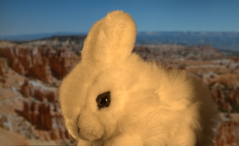
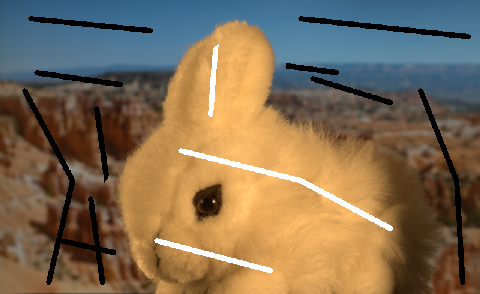
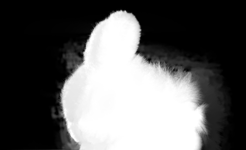

[](LICENSE)

# Image Matting with a Closed-Form Solution

Image matting estimates the opacity (alpha matte) of a foreground object in an image, so that the object can be extracted and composited onto a new background. It is widely used in image editing and visual effects.

## Overview

This repository contains a Python implementation of the closed-form matting method of A. Levin, D. Lischinski, and Y. Weiss, *A Closed-Form Solution to Natural Image Matting*. Given an image and a few user scribbles (white for foreground, black for background), the method computes the alpha matte by solving a sparse linear system built from the matting Laplacian.

The IPOL article describing this work, with a complete derivation of the method and the pseudocode of this implementation, is available at [https://www.ipol.im/pub/pre/532/](https://www.ipol.im/pub/pre/532/).

## Online Demo

An online demo is available [here](https://ipolcore.ipol.im/demo/clientApp/demo.html?id=532). You can run the algorithm on the provided examples, or upload your own image and scribbles to obtain the estimated alpha matte.

Here is an example of an input image, the scribbled image, and the resulting alpha matte:

| Original image | Scribbled image | Output alpha |
|----------------|-----------------|--------------|
|  |  |  |

## Installation

1. Clone the repository:
```bash
git clone https://github.com/reproductible-research/image-matting-with-a-closed-form-solution.git
cd image-matting-with-a-closed-form-solution
```

2. Create a conda environment with Python 3.9:
```bash
conda create -n matting python=3.9 -y
conda activate matting
```

3. Install the required packages:
```bash
pip install -r requirements.txt
```

## Usage

Run the main script with the input image and the scribbled image:
```bash
python main.py input_image.png -s scribbles.png -r 1 -e 1e-5
```

The alpha matte is written to `output.png`.

Options:
- `-s`, `--scribbles`: scribbled image (required).
- `-r`, `--radius`: window radius, `1` (3×3 windows, default) or `2` (5×5 windows).
- `-e`, `--epsilon`: regularization parameter ε, one of `1e-5` (default), `1e-4`, `1e-3`, `1e-2`.

### Preparing the scribbled image

The scribbled image must be a copy of the input image with the same size, in which:
- foreground pixels are painted pure white `(255, 255, 255)`,
- background pixels are painted pure black `(0, 0, 0)`,
- all the other pixels are left **exactly** unchanged.

Every pixel that differs from the input image is treated as a scribble, so save the scribbled image in a lossless format (PNG), and do not resize or re-encode it. A trimap can also be given in the same format: the unknown region keeps the original pixels.

### Memory and running time

The linear system is solved with a direct sparse solver, whose memory use grows quickly with the image size and the window radius. For example, a 640×480 image takes about 40 s and 2 GB of memory with `-r 1`, and about 5 min and 6 GB with `-r 2`. For larger images, use `-r 1` or resize the image first.

## Reference

- Anat Levin, Dani Lischinski, and Yair Weiss, [A closed-form solution to natural image matting](https://doi.org/10.1109/TPAMI.2007.1177), IEEE Transactions on Pattern Analysis and Machine Intelligence, 30 (2008), pp. 228–242.

## License

This project is released under the [GNU General Public License v3.0](LICENSE).
